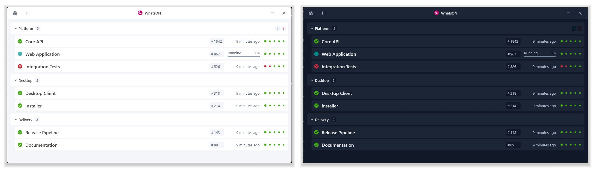

# whatsON

**Build monitoring for Windows, with support for Jenkins and CruiseControl.NET.**

whatsON is a C# desktop application that brings build status, progress, and recent
results into one view. Monitor projects across multiple build servers and receive
Windows notifications when builds need your attention.

[Report a bug](https://github.com/Soloplan/whatson/issues/new?template=bug.md) ·
[Request a feature](https://github.com/Soloplan/whatson/issues/new?template=feature.md&labels=feature) ·
[Download the latest release](https://github.com/Soloplan/whatson/releases/latest)



## Contents

- [Features](#features)
- [Getting started](#getting-started)
- [Appearance and language](#appearance-and-language)
- [Building from source](#building-from-source)
- [Plugins](#plugins)
- [Documentation and support](#documentation-and-support)
- [Contributing](#contributing)
- [License](#license)
- [Creators](#creators)

## Features

- Monitor multiple projects and build servers in one application.
- Connect to Jenkins and CruiseControl.NET with the included plugins.
- View build status, progress, and additional build information.
- Review the five most recent builds with the Jenkins plugin.
- Add projects through a guided setup wizard and configure them from the main window.
- Receive configurable Windows notifications.
- Choose a light or dark appearance, or follow the Windows theme automatically.
- Use the interface in English or German.
- Extend support to other build systems through custom plugins.

## Getting started

1. [Download the latest release](https://github.com/Soloplan/whatson/releases/latest).
2. Place the application files in the directory from which you want to run whatsON.
3. Launch `Soloplan.WhatsON.GUI.exe`.
4. Select the plus icon in the upper-left corner to add a project with the setup wizard.
5. To launch whatsON automatically at sign-in, open Settings using the gear icon and enable **Run when Windows starts**.

Framework-dependent builds require the
[.NET 10 Desktop Runtime for Windows](https://dotnet.microsoft.com/en-us/download/dotnet/10.0).
The self-contained MSIX package includes its runtime.

## Appearance and language

Under **Settings → General → Color theme**, select **System**, **Light**, or
**Dark**. Theme changes preview immediately. Select **Save changes** to keep them;
resetting or closing Settings restores the saved appearance.

Under **Settings → General → Language**, select **System**, **English**, or
**Deutsch**, save your changes, and restart whatsON. **System** follows the Windows
display language when it is English or German and uses English otherwise.
Configurations without a language preference also use **System**. Explicit
language choices are preserved when importing or exporting configuration.

## Building from source

### Prerequisites and commands

Install the .NET 10 SDK on Windows, then run these commands from the repository
root. Publish into an empty output directory to avoid including files from older
builds.

```powershell
dotnet build src/Soloplan.WhatsON.slnx -c Release
dotnet test src/Soloplan.WhatsON.slnx -c Release --no-build
dotnet publish src/Soloplan.WhatsON.GUI/Soloplan.WhatsON.GUI.csproj -c Release -o src/bin/Release
```

Launch `src/bin/Release/Soloplan.WhatsON.GUI.exe`. Distribute the entire publish
directory, including dependencies, plugins, `.deps.json`, `.runtimeconfig.json`,
and the `de` localization folder. This framework-dependent build requires the
.NET 10 Desktop Runtime for Windows. External plugins built for .NET Framework
must be migrated and rebuilt for .NET 10.

Shared project settings are in `src/Directory.Build.props` and
`src/Directory.Build.targets`; package versions are in
`src/Directory.Packages.props`.

### Tests and continuous integration

The test command above runs all tests. Tests categorized as **Integration** require
external services; **UI** tests require a desktop environment. The GUI test
assembly inherits the **UI** category.

Jenkins uses `SoloPipeline@1.7` in the Windows `dotnet-framework` build container
with the .NET 10 SDK. It builds and tests the full solution, excluding the
`Integration` and `UI` categories. To run the same test selection locally:

```powershell
dotnet test src/Soloplan.WhatsON.slnx -c Release --no-build --filter "TestCategory!=Integration&TestCategory!=UI"
```

CI archives NUnit results and skips packaging and publishing after test failures.
Snapshots are published to `whatson/beta` for `master` and `whatson/alpha` for
`develop`. Tags are published to their own release folders.

### Versioning and packaging

Build versions use `1.yyMM.build-channel`, where `yyMM` is the UTC build start
month and `build` is the Jenkins build number. For example:

| Build | Version example |
| --- | --- |
| Develop or feature branch | `1.2610.42-alpha` |
| Master | `1.2610.42-beta` |
| Release tag `v1.2610.42` | `1.2610.42` |
| Local build | `1.2610.0-local` |

Jenkins passes the complete `TAG_NAME` as the release version.
`Directory.Build.props` removes an optional leading `v`; the remaining value
must be a valid SDK version. Prerelease tags such as `v1.2610.42-rc.1` are also
supported. Jenkins build numbers are scoped to each job.

All projects use the SDK `Version` property. The About dialog displays
`AssemblyInformationalVersion`, including the channel suffix and Git commit
metadata added by the SDK.

MSIX packaging is separate from the normal solution build and requires Visual
Studio's Windows packaging tools. Jenkins also produces a self-contained x64
MSIX package and an App Installer update feed, with Azure signing for
`master`, `develop`, and tag builds. GitHub release uploads are manual.
See [MSIX packaging and updates](src/Soloplan.WhatsON.Package/README.md) for
prerequisites, signing, channel URLs, and upload instructions.

### Localization

Shared interface text is stored in
`src/Soloplan.WhatsON/Localization/Strings.resx` and `Strings.de.resx`.
Edit the resource files directly; the .NET SDK generates the public `Strings`
class during each build.

Use `Strings.None` in C# and `{x:Static loc:Strings.None}` in WPF, with `loc` mapped
to `clr-namespace:Soloplan.WhatsON.Localization;assembly=Soloplan.WhatsON`.
For messages with arguments, use named methods such as
`Localizer.DeleteNamedProject(projectName)`. Use `Localizer.GetStateName(state)`
for build states. Resource properties and method arguments are checked by the
compiler. Keep resource keys and formatting placeholders consistent across both
translations.

English is the fallback for untranslated cultures. Project names, URLs,
server-provided descriptions, and diagnostic logs retain their original content.
Existing validation, tray, and connector settings resources remain in the
`Properties/Resources*.resx` and `Properties/ConfigurationItems*.resx` files of
their owning projects. These use standard .NET satellite resources.

Localization tests cover translation completeness, formatting placeholders,
fallback behavior, persistence, and translated controls.

### Property notifications

View-model property notifications use PropertyChanged.Fody with the shared
`src/FodyWeavers.xml` configuration. Notification roots are partial classes
implementing `INotifyPropertyChanged`; Fody generates the events and invokers.
Each presentation plugin assembly needs its own Fody and PropertyChanged.Fody
package references to weave its setters.

The former `NotifyPropertyChanged` base class has been removed. External plugins
that inherit from it must migrate and rebuild.

## Plugins

whatsON includes connectors for:

- [Jenkins](https://jenkins.io/)
- [CruiseControl.NET](https://github.com/ccnet/CruiseControl.NET)

Custom plugins can add support for other build systems. See the
[plugin development guide](https://github.com/Soloplan/whatson/wiki/Developing-a-new-plugin)
and the community [Travis CI plugin](https://github.com/steffen-wilke/whatson-travis-ci)
for an example.

## Documentation and support

Visit the [project wiki](https://github.com/Soloplan/whatson/wiki) for additional
documentation. Before reporting a bug or requesting a feature, search both open
and closed issues. If your topic has not been covered,
[open a new issue](https://github.com/Soloplan/whatson/issues/new).

## Contributing

Contributions, bug reports, and community plugins are welcome. Read the
[contribution guidelines](https://github.com/Soloplan/whatson/wiki/Contribiution)
before submitting changes.

For work with coding agents, [AGENTS.md](AGENTS.md) describes the repository
layout, Windows build prerequisites, test commands, coding conventions, and
coordination guidance.

## License

whatsON is distributed under the [MIT license](LICENSE).

## Creators

- Christian Heidl
- [Steffen Wilke](https://github.com/steffen-wilke)
- [Dominik Gouda](https://github.com/dominikgolda)
- [Krzysztof Lorenc](https://github.com/krzysztof-lorenc)
- [Tomasz Skowron](https://github.com/skowront)
- [GamesAgeddon](https://github.com/GamesAgeddon)
